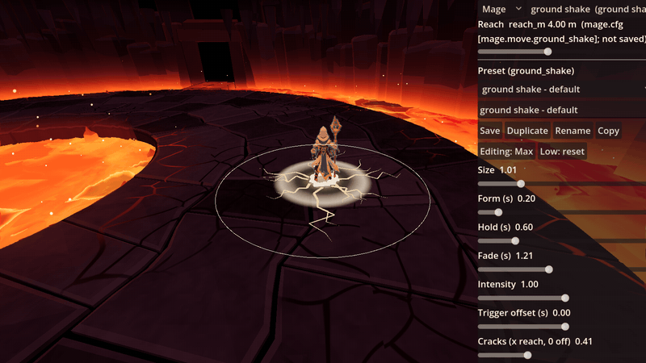

# Unwarded VFX Lab



A small Godot 4 workbench for spell effects: a character casts a move on a real arena floor, at the game camera, and you tune the effect live with sliders while it plays. Slow motion, frame steps and exact replays let you look at any moment of a cast. It comes out of the action game [Unwarded](#where-this-comes-from), with its Mage and the volcano's ring arena as the example content.

**[Try it in your browser](https://zigoulle.github.io/unwarded-vfx-lab/)**: nothing to install. (The browser version draws with a simpler renderer; see [what differs on the web](docs/web.md).)

## What you can do with it

- Watch each of the Mage's six effects (sand slash, blink, ground shake, whirlwind, tornado, time slow) on the move it belongs to, timed to the move's real hit.
- Move the knobs (size, timing, colours, and each effect's own shape knobs) and see the change at once, even while paused.
- Save your settings as named presets, duplicate and rename them, or copy one as text.
- Check that an effect is fair: the lab outlines the move's real hit area on the floor and warns when the drawn effect reaches further or shorter than the hit.
- Check that it is cheap enough: a live count of particles, layers and triangles against a budget, and a GPU cost measure.
- Swap in your own effects, character and arena (the guide shows how).

## Run it on your computer

1. Download **Godot 4.7** (the standard version, not .NET) from [godotengine.org/download](https://godotengine.org/download). It is one program; no installer.
2. Download this repository: the green **Code** button on GitHub, then **Download ZIP**, and unzip it. (Or `git clone` it.)
3. Start Godot. In the Project Manager click **Import**, pick the `project.godot` file in the unzipped folder, then **Import & Edit**. The first open takes a minute while Godot imports the model and textures.
4. Press **F5** (or the ▶ button at the top right). The lab opens.

Then press **Space** to cast.

## Documentation

- **[The guide](docs/guide.md)**: what the lab is, how to run it, the screen, the keys, how the knobs and presets work, and step by step how to swap in your own effect, character and arena. With screenshots.
- [What differs in the browser](docs/web.md).
- [The tuning pages](tuning/README.md): the numbers the lab reads (the Mage's moves, the camera, the arena).

## Keys at a glance

| Key | Does |
|---|---|
| Space | Cast (a new random seed) |
| R | Replay the same cast |
| P | Pause / resume |
| S | Slow motion (0.1x) |
| Left / Right | One frame back / on |
| L | Loop the cast |
| M / N | Next / previous move |
| V | Next effect |
| Right mouse drag, wheel | Orbit, zoom |
| G | Back to the game camera |
| C | Measure the effect's GPU cost |
| H | Hide / show the help box |

## Check it still works

A headless smoke test casts every effect and tries the reach slider and the preset buttons:

```bash
godot --headless --path . res://tests/smoke_test.tscn
```

It prints `PASS` (exit code 0) or the first thing that broke.

## Where this comes from

Unwarded is an action game made by Pier-Olivier Martel in Godot. The lab is the tool its effects were tuned in. This repository is the lab on its own: the game's combat, enemies, other characters and zones are not here. Where the lab needed something from the game (the Mage's move timings, the arena's floor), it carries a small stand-in that reads the same tuning pages the same way.

## Licence

MIT, for everything in this repository: the code, the effects and presets, the Mage (model, rig, animations and textures) and the ring arena. See [LICENSE](LICENSE). The few third-party pieces are MIT or CC0 and are credited in [THIRD_PARTY_LICENSES.md](THIRD_PARTY_LICENSES.md).
