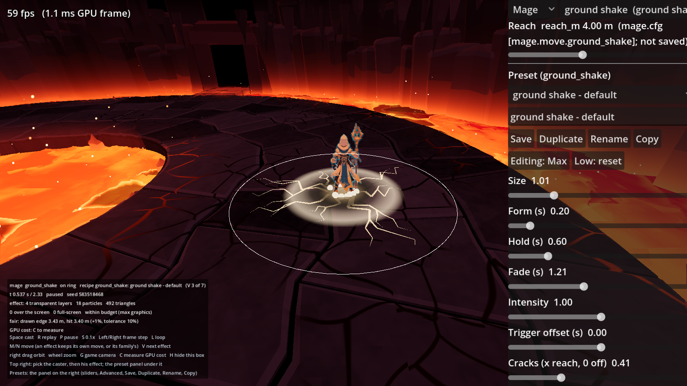
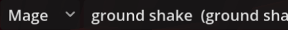
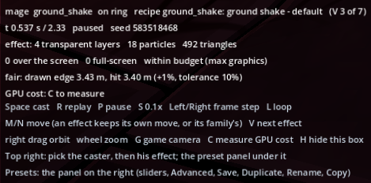
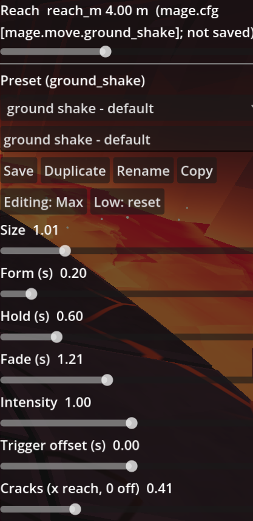
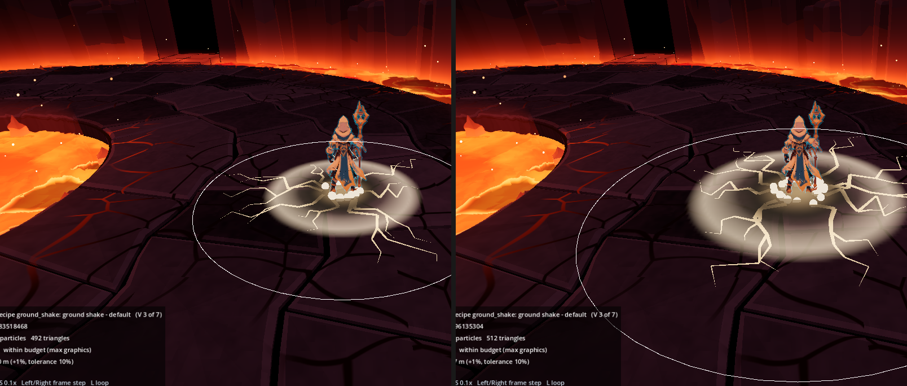
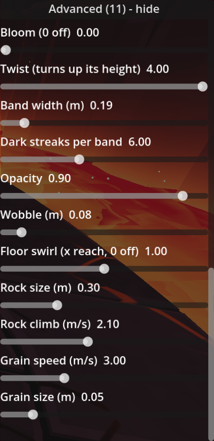

# The VFX Lab guide

This guide is for anyone who wants to play with the lab or use it for their own effects. You do not need to know Godot to follow parts 1 to 4. Parts 5 to 7 change files, and say exactly which.

1. [What the lab is](#1-what-the-lab-is)
2. [Run it](#2-run-it)
3. [The screen](#3-the-screen)
4. [The knobs and presets](#4-the-knobs-and-presets)
5. [Swap in your own effect](#5-swap-in-your-own-effect)
6. [Swap in your own character](#6-swap-in-your-own-character)
7. [Swap in your own arena](#7-swap-in-your-own-arena)
8. [When something goes wrong](#8-when-something-goes-wrong)

---

## 1. What the lab is

A spell effect in a game is a short show: a slash of sand, a burst, cracks on the floor, a tornado. It has to look good, land on the frame the hit lands, cover the area the hit really covers, and not cost too much to draw. The lab is a small stage for exactly that:

- a **caster** (here, the Mage from the game Unwarded) plays a real **move** of his, with its real timing;
- on a real **arena floor** (the volcano's ring arena), seen from the game's own camera;
- the **effect** plays on that move, starting on the move's hit;
- a **panel of knobs** changes the effect while it plays.

The lab does not run a game: there are no enemies, no health, no controls for walking. It only plays a move and draws its effect, as many times as you like, as slowly as you like.

A few words the guide uses:

| Word | Means |
|---|---|
| **Recipe** | The code that draws one kind of effect (the sand slash, the tornado). It has knobs. |
| **Preset** | A named, saved set of a recipe's knob values ("tornado - sand"). One recipe can have many presets. |
| **Knob** | One setting of a recipe: its size, its colours, how long it holds, how many grains of sand. |
| **Move** | What the caster does (light_1, whirlwind, tornado). Each recipe belongs to one move or a family of moves. |
| **Hit** | The frame the move's blow lands, and the area it covers. The effect is timed to it and sized from it. |

## 2. Run it

### In the browser

Open **[the lab's web page](https://zigoulle.github.io/unwarded-vfx-lab/)** in Chrome, Edge or Firefox on a computer, and wait for it to load (about 65 MB the first time; the browser keeps it after that). Click once in the picture so it gets the keyboard, then press **Space**.

The browser version is the same lab with a simpler renderer: a few looks differ, and saved presets stay in that browser only. See [What differs in the browser](web.md).

### On your computer

1. Download **Godot 4.7** (the standard version, not .NET) from [godotengine.org/download](https://godotengine.org/download). Unzip it; the program runs as it is.
2. On this repository's GitHub page, click **Code**, then **Download ZIP**, and unzip it somewhere you will find it. (If you use git: `git clone` the repository instead.)
3. Start Godot. The **Project Manager** opens. Click **Import**, browse to the unzipped folder, pick `project.godot`, then click **Import & Edit**.
4. The Godot editor opens. The first time it spends a minute importing the Mage's model and the textures (a progress bar at the bottom).
5. Press **F5**, or click the ▶ (Run Project) button at the top right. The lab opens in its own window.

Next time, double-click the project in the Project Manager and press F5.

## 3. The screen



| Where | What it is |
|---|---|
| Middle | The Mage on the ring arena, at the game's camera. A thin outline on the floor shows the move's hit area. |
| Top right | **The picker**: the caster, then his effect. Each effect is listed with the move it plays on. |
| Right | **The preset panel**: the knobs of the effect shown (part 4). |
| Top left | The frame rate and the GPU time of the last frame. |
| Bottom left | **The help box**: what is playing, the clock, the effect's cost, whether it is fair, and the keys. **H** hides it. |

### Pick an effect



Click the second drop-down in the picker and choose an effect, or press **V** to step to the next one. The Mage moves to the right move by himself. The last entry, **placeholder**, is a simple spark burst that plays on any move: handy to try timing knobs, and a starting point for a new recipe.

### Play it

| Key | Does |
|---|---|
| **Space** | Cast: the Mage plays the move and the effect plays on its hit. Each cast has a new random seed (the sand falls a little differently). |
| **R** | Replay the same cast, with the same seed: exactly the same picture. |
| **P** | Pause, and resume. |
| **S** | Slow motion (one tenth of the speed), and back. |
| **Right** or **.** | One frame on (pauses). |
| **Left** or **,** | One frame back (pauses). The effect is drawn from the time alone, so stepping back is exact. |
| **L** | Loop the cast. |
| **M** / **N** | Next / previous move. On an effect with a family of moves (the sand slash on the three light slashes, the whirlwind on two spins), they pass between those. On the placeholder they pass through all his moves. |
| **Right mouse drag** | Orbit the camera round him. |
| **Mouse wheel** | Closer / further. |
| **G** | Back to the game's camera. |
| **C** | Measure the effect's GPU cost: the cast loops, and after a few seconds the help box shows the frame's GPU time with the effect and without it. |
| **H** | Hide or show the help box. |

The keys work while the mouse is over the 3D view. If you typed in the preset name field, press **Enter** or click in the 3D view to give the keys back.

### Read the help box



- **Line 1**: the caster, the move, the floor, the recipe and the preset drawn.
- **Line 2**: the clock (seconds into the cast, and the cast's length), the speed, and the seed.
- **Line 3**: what the effect draws right now: see-through layers, particles, triangles.
- **Line 4**: how many layers cover the screen, and whether that is **within budget** or **OVER BUDGET**. The budget is 3 see-through layers over the screen and 128 particles (2 and 64 for the Low version), and no full-screen pass.
- **Line 5**: whether it is **fair**: the effect's drawn edge on the floor against the move's real hit reach, within 10%. **UNFAIR** means a player would see the effect reach further (or shorter) than the hit.
- **Line 6**: the GPU cost, once measured with **C**.

## 4. The knobs and presets



From the top down:

### The reach slider

The move's **real hit reach**, read from the Mage's tuning page (`tuning/mage.cfg`; the label names the line). Moving it changes the hit, as if the move were tuned bigger or smaller: the outline on the floor follows, and so does every knob marked "x reach". This is how you check that an effect still fits when the game's designer changes a move.

The lab never writes the page: the reach is back to the page's value next time you open the lab. To keep a new reach, open `tuning/mage.cfg` in a text editor and write the value on the line the label names.



### The preset list and its buttons

- The **drop-down** lists the saved presets of this recipe. Picking one loads it (unsaved changes are dropped).
- The **name field** holds the name the buttons use.
- **Save**: saves the knobs under the name in the field. A new name saves a new preset.
- **Duplicate**: saves a copy under the field's name (or "<name> copy") and switches to it.
- **Rename**: renames the saved preset to the field's name.
- **Copy**: puts the preset's file text on the clipboard, to paste into a file or a message.

Where presets are saved:

- **Run from Godot** (part 2, on your computer): in the project, as `fx/presets/<recipe>/<name>.tres`. They are plain text files you can keep, share or commit.
- **In the browser**: inside that browser's own storage. They stay there between visits in the same browser, but nowhere else. To take one with you, use **Copy** and paste the text into a file named `<name>.tres` in `fx/presets/<recipe>/` of your own copy.

### Max and Low

Games draw effects cheaper on low graphics settings. **Editing: Max** (pressed: **Editing: Low**) switches the effect to its **Low version**: fewer particles, no glow. The knobs then show and change the Low version only, and the budget line checks the Low budget. **Low: reset** forgets your Low changes and goes back to the automatic Low version. Both versions are saved in the same preset.

### The shared knobs

Every recipe has these:

| Knob | Does |
|---|---|
| **Size** | Scales the whole effect. 1 is the recipe's own size. |
| **Form (s)** | How long it takes to build up before the hit. |
| **Hold (s)** | How long it stays at full strength after the hit. |
| **Fade (s)** | How long it takes to fade out after the hold. |
| **Intensity** | How bright its glow and flash are. |
| **Trigger offset (s)** | Moves the effect earlier (negative) or later (positive) than the move's hit. |
| **Core colour**, **Edge colour** | The effect's two colours: its bright core and its outer edge (the sand's light and dark tones). Click to pick. |
| **Bloom** (under Advanced) | Turns on a soft glow over the scene while the effect plays. 0 is off. |

### The recipe's own knobs

Under the shared knobs come the knobs of the effect itself: a slash's radius and sweep, a tornado's height and bands, how many grains of sand, how fast they fly. A knob marked **(x reach)** is a share of the move's hit reach rather than metres: at 1.0 it ends exactly on the hit's edge, whatever the move's reach. **Advanced (n) - show** opens the rest of the recipe's knobs.



### Make a move use a preset in your own copy

Each of the Mage's moves names the preset it plays on its tuning page. Open `tuning/mage.cfg` and find the `[mage.look]` section at the end:

```ini
[mage.look]
ground_shake_fx = "ground shake - default"
sand_slash_fx = "sand slash - default"
whirlwind_fx = "whirlwind - default"
tornado_fx = "tornado - sand"
blink_fx = "blink - default"
ultimate_fx = "time slow - default"
```

Write the name of your saved preset in quotes. A game that uses these recipes (Unwarded does) reads this line to know what to draw. The lab's panel itself opens each recipe on its first saved preset by name.

## 5. Swap in your own effect

A recipe is one GDScript file in `fx/`. The quickest start is to copy one that is close to what you want.

1. **Copy a recipe.** In Godot's FileSystem panel (bottom left), right-click `fx/fx_blink.gd` (a streak and a burst) or `vfx_lab/placeholder_effect.gd` (the simplest: sparks only) and choose **Duplicate**. Name it, say, `fx/fx_sand_burst.gd`.
2. **Rename it inside.** Open the copy. At the top, change `class_name FxBlink` to `class_name FxSandBurst`, `RECIPE := "blink"` to `RECIPE := "sand_burst"` and `DEFAULT_NAME` to `"sand burst - default"`. (The placeholder has no `class_name` or `DEFAULT_NAME`: add both, and `KNOBS := {}` and `ADVANCED_KNOBS := {}`, copying their shape from `fx/fx_blink.gd`.)
3. **Its knobs.** `KNOBS` and `ADVANCED_KNOBS` list the knobs the panel shows: `"knob_name": ["Label", min, max, step]`. `default_preset()` returns the starting values. In `show_at(seed, t)` (called every frame with the time since the cast), read a knob with `preset.knobs["knob_name"]` and the shared ones with `preset.size`, `preset.fade_s`, `preset.core_colour`. Draw only from `seed` and `t`: that is what makes replays and frame steps exact.
4. **Tell the lab about it.** Three one-line additions:
   - `fx/fx_reach.gd`, in `script_of`: `FxSandBurst.RECIPE: return FxSandBurst` (two lines, like the others).
   - `fx/fx_moves.gd`, in `MOVES`: which move it plays on, for example `"sand_burst": {"character": "mage", "move": "ground_shake", "knob": []},`.
   - `vfx_lab/vfx_lab.gd`, in `RECIPES`: add `"sand_burst"`.
5. **Run the lab** (F5), pick your effect in the picker, and press **Save** in the panel: its first preset is written to `fx/presets/sand_burst/`.

To make its ground footprint follow the move's reach (knobs "x reach", and the fairness line), add its entries to `TIES`, `EDGES` and `REFERENCE` at the top of `fx/fx_reach.gd`, as the Mage's recipes have.

The building blocks the recipes share are in `fx/`: `FxRibbon` (bands and crescents), `FxParticles` (sprites), `FxBurst` (a ring burst laid on the floor), `FxGroundMarks` (scorches and cracks), `FxDebris` (rocks), `FxNoise`. Their particle sprites are Kenney's (`vfx/kenney-particle-pack/`).

## 6. Swap in your own character

The caster is `MageModel` (`scenes/mage_model.gd`): it loads the model, picks the animation frame each move asks for, and carries the staff. The Mage's moves and their timings come from his tuning page, read by `MoveKit` (`sim/move_kit.gd`).

The simplest swap keeps all of that and changes the model:

1. **Export your character** from Blender (or any 3D tool) as one `.glb` file: one mesh on a skeleton, with an animation for each move, standing at the origin, facing +Z, in metres.
2. **Name its animations like the Mage's**: `idle`, `slash_1`, `slash_2`, `slash_3`, `whirlwind`, `whirlwind_2`, `tornado`, `ground_shake`, `cast`, `dash`, `run`, `hit`, `stagger`, `defeat`. (`scenes/mage_clips.gd`, `MOVES`, says which animation each move plays and its start, hit and end frames: change those frame numbers to your animations' own.)
3. **Copy the clip sheet.** Copy `assets/mage/mage-clips.json` next to your model and edit it: `height_m` (the model's own height), each clip's `frames`, `start`, `hit`, `end` and `loop`, `run_stride_m_per_s`, the bone the staff is held by (`staff`), and the cloth chains (`cloth`: set it to `[]` if your character has none).
4. **Point the caster at your files.** In `scenes/mage_model.gd`, change the three paths at the top: `SCENE` (your model), `STAFF` (a held prop, or keep the Mage's staff), `CLIPS_JSON` (your clip sheet). Change `MODEL_HEIGHT_M` in `scenes/mage_look.gd` to your model's height.
5. **Size and moves.** The drawn height is `mage_height_m` in `tuning/camera-and-arena.cfg`. Your moves' timing and reach are the `[mage.move.<name>]` sections of `tuning/mage.cfg`.
6. Press F5. The picker still says "Mage"; the name list is `CHARACTERS` in `vfx_lab/vfx_lab.gd`.

A character with different moves needs more: its moves in `MOVES` of `vfx_lab/vfx_lab.gd`, its rows in `tuning/mage.cfg`, and its clip table in `scenes/mage_clips.gd`. The Mage's files are a complete example of all three.

## 7. Swap in your own arena

The floor is built by `vfx_lab/lab_floors.gd`. The ring arena is `RingArenaView` (`scenes/ring_arena_view.gd`), sized by `tuning/volcano.cfg`.

To stand the caster on your own scene instead:

1. **Make the scene** in Godot: a `Node3D` with your floor's meshes under it, the floor's top at height 0 around the origin. Save it, say, as `arenas/my_arena.tscn`. If it should bring its own lighting, add a `WorldEnvironment` and lights to it: the lab then turns its own light off.
2. **Add a builder.** In `vfx_lab/lab_floors.gd`, add `"my_arena"` to `KINDS`, and a line in `build`:
   ```gdscript
   "my_arena":
       return (load("res://arenas/my_arena.tscn") as PackedScene).instantiate()
   ```
3. **Where he stands.** `stand_spot` says where the caster stands on each floor (the ring: halfway across it). Any other floor stands him at the origin.
4. **Open on it.** In `vfx_lab/vfx_lab.gd`, set `var floor_kind := "my_arena"`.

The lab finds the floor's height under the caster from your meshes (`level_round`), so he and the ground marks sit on top of it.

## 8. When something goes wrong

| What you see | What to do |
|---|---|
| "Tuning page error" on screen | A page in `tuning/` has a line Godot cannot read. The message names the page. Each line must be `key = value`, a `[section]`, or a comment starting with `;`. Text values need double quotes. |
| The keys do nothing | Click once in the 3D view (in the browser, click in the picture). The name field keeps the keys while you type in it. |
| The effect looks different in the browser | Expected for some looks: [What differs in the browser](web.md). |
| A preset I saved in the browser is gone | Presets saved in the browser stay in that browser's storage only. Clearing the site's data removes them. Use **Copy** to keep one. |
| The first open in Godot shows errors and pink materials | Let the first import finish (the progress bar at the bottom of the editor), then close and reopen the project. |
| Check everything still works | `godot --headless --path . res://tests/smoke_test.tscn` prints `PASS` or what broke. |
